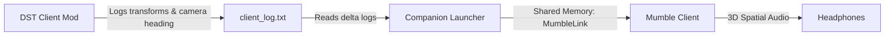

# 🎙️ Don't Starve Together - 3D Proximity Voice Chat (Mumble Bridge)

Bring realistic, zero-latency **3D Proximity Voice Chat** to *Don't Starve Together*! 

Hear your friends in true 3D spatial audio: sound gets quieter with distance and moves across your stereo headset based on where their characters are standing and how your camera is angled.

---

## ✨ Features

* 🎧 **True 3D Positional Audio:** Distance attenuation and stereo panning powered by Mumble's ultra-low latency audio engine.
* 🔄 **Dynamic Camera Orientation (v1.1.0+):** Rotating your game camera with `Q` or `E` updates audio orientation in real time so sound always matches your screen perspective.
* 🕳️ **Cave & Surface Isolation:** Players deep in the caves and survivors on the surface are acoustically isolated (+50,000m vertical offset).
* 🌐 **100% Client-Side:** Works on **any multiplayer server** (public or dedicated). The server host does *not* need to install the mod!
* ⚡ **Performance & Log Optimized:** Intelligent delta filtering ensures coordinates are only logged during actual movement.
* 🖥️ **Standalone Companion Launcher:** Ready-to-use binaries for **Windows 10/11** and **Linux (Ubuntu/Debian)** with a clean GUI and 1-click Mumble setup.

---

## 🚀 Quick Start Guide

### Step 1: Install & Enable the DST Mod
1. Subscribe to the **Proximity Voice (Mumble Bridge)** mod on the **Steam Workshop** (or copy `dst_mod` into your local `mods/dst_proximity_voice` directory).
2. Launch *Don't Starve Together*.
3. Go to **Mods** $\rightarrow$ **Client Mods** and enable **Proximity Voice (Mumble Bridge)**.

> *Note: Because this is a Client Mod, you can join any server and it will remain active.*

---

### Step 2: Install & Set Up Mumble
1. **Download Mumble:**
   * **Windows:** Download and install from [mumble.info](https://www.mumble.info/).
   * **Linux:** `sudo apt install mumble`
2. **Enable Positional Audio in Mumble:**
   * Open Mumble $\rightarrow$ **Settings** $\rightarrow$ check **Advanced** (bottom left).
   * Under **Plugins**: Check **„Link to Game and Transmit Position“**.
   * Under **Audio Output** $\rightarrow$ **Positional Audio**:
     * Check **Turn on Positional Audio**.
     * **Minimum Distance:** `2.0 m`
     * **Maximum Distance:** `35.0 m`
     * **Minimum Volume:** `0 %` *(Crucial: Ensures distant players are completely muted).*
3. Connect with your friends to the same Mumble server and join the same voice channel.

---

### Step 3: Run the Launcher
Download the standalone launcher from the latest **[GitHub Releases](https://github.com/Traizzy1104/dst-proximity-voice/releases/latest)**:

* **Windows:**
  * Download `DST-Voice-Launcher-Windows.exe` and double-click to run. No installation or Python required.
* **Linux:**
  * Download `DST-Voice-Launcher-Linux`.
  * Make it executable (`chmod +x DST-Voice-Launcher-Linux` or right-click $\rightarrow$ *Properties* $\rightarrow$ *Allow executing as program*) and run it.

The launcher GUI will automatically detect your DST game logs:
* You will see: `Status: Connected | X: ... Y: ... Z: ... | Cam: ...°`.
* Click **"Mumble automatisch konfigurieren"** if you want the launcher to set up Mumble Link files automatically.

Join your game and enjoy proximity chat!

---

## 🏗️ How It Works (Architecture)



1. **DST Client Lua Mod:** Hooks into `ThePlayer` and `TheCamera` within the game's update loop, outputting delta coordinates (`X, Y, Z, Facing, Heading`) to `client_log.txt`.
2. **Launcher / Bridge:** Real-time tailing reads log lines and translates game coordinates into Mumble's native `MumbleLink` shared memory structure (`/dev/shm/MumbleLink` on Linux, `Win32 Shared Memory` on Windows).
3. **Mumble:** Handles the Opus voice codec, server routing, and mathematical 3D sound attenuation.

---

## 🛠️ Building from Source (Optional)

If you prefer to run or build from Python source:

### Requirements
* Python 3.10+
* Tkinter (standard with Python on Windows; `sudo apt install python3-tk` on Ubuntu)

### Run with Python
```bash
# Clone repository
git clone https://github.com/Traizzy1104/dst-proximity-voice.git
cd dst-proximity-voice

# Run directly
python3 launcher.py
```

### Build Standalone Executables
```bash
pip install pyinstaller
pyinstaller --onefile --noconsole --name "DST-Voice-Launcher" launcher.py
```

---

## 📜 License & Credits

Distributed under the MIT License. Contributions and feedback are welcome!
